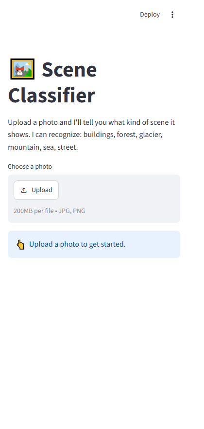
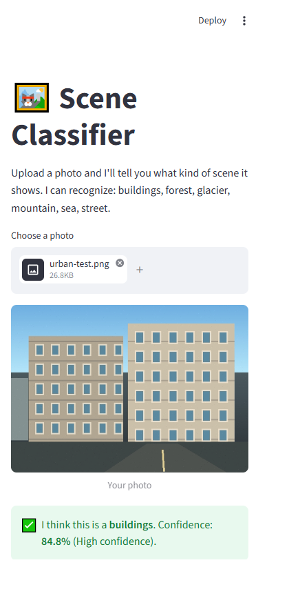

# Scene Classifier (intelimage)

A friendly, browser-based app that looks at a photo and tells you what kind of scene it shows. Upload an image, and the app predicts one of six scene categories, along with how confident it is.

Built with [Streamlit](https://streamlit.io/) for the interface and [TensorFlow / Keras](https://www.tensorflow.org/) for the image classifier.

---

## Table of contents

1. [Features](#features)
2. [Screenshots](#screenshots)
3. [Recognized classes](#recognized-classes)
4. [How it works](#how-it-works)
5. [Project structure](#project-structure)
6. [Requirements](#requirements)
7. [Setup](#setup)
8. [Configuration (Kaggle token)](#configuration-kaggle-token)
9. [Running the app](#running-the-app)
10. [Using the app](#using-the-app)
11. [Model details](#model-details)
12. [Confidence levels](#confidence-levels)
13. [Troubleshooting](#troubleshooting)
14. [Security notes](#security-notes)

---

## Features

- **Simple upload flow**: choose a `.jpg`, `.jpeg`, or `.png` photo and see the result immediately.
- **Clear prediction message**: the top class, the confidence as a percentage, and a confidence level (High, Medium, or Low).
- **Full breakdown**: a bar chart showing the probability of every class.
- **Automatic model download**: if the trained model is not on disk, the app downloads it from a Kaggle kernel output.
- **Cached model**: the model loads once per server session, so later predictions are fast.

## Screenshots

The app's upload screen and an example prediction:





## Recognized classes

The model predicts one of six scene categories. The order below is the order the model uses internally:

| Index | Class       |
|-------|-------------|
| 0     | `buildings` |
| 1     | `forest`    |
| 2     | `glacier`   |
| 3     | `mountain`  |
| 4     | `sea`       |
| 5     | `street`    |

The class order is alphabetical. It matches the folder order used when the model was trained. If you retrain the model with a different class order, update `CLASS_NAMES` in [app.py](app.py).

## How it works

1. **Load the model.** On first use, [app.py](app.py) checks for `model/best_scene_model.keras`. If the file is missing, it runs the Kaggle CLI to download the kernel output `amirzeaiter/intelimage-classification` into `model/`. The model is then loaded and cached with `st.cache_resource`.
2. **Read the upload.** The uploaded file is opened with Pillow.
3. **Preprocess.** The image is converted to RGB, resized to 224 × 224 pixels, and turned into a batch of one. Pixel values are left in the 0–255 range. The model rescales them internally.
4. **Predict.** The model returns six probabilities that add up to 1. The highest one is the predicted class, and its value is the confidence.
5. **Show the result.** The app displays the prediction message, the confidence level, and a bar chart of all six probabilities.

## Project structure

```
intelimage/
├── app.py                # Streamlit app: UI, model loading, prediction
├── README.md             # This documentation
├── screenshots/          # App screenshots shown in this README
│   ├── scene-classifier.png
│   └── prediction-result.png
├── .env                  # Local secrets (Kaggle token). Do not commit.
├── .gitignore
├── .vscode/
│   └── settings.json     # Enables loading .env in VS Code terminals
├── .venv/                # Local Python virtual environment (ignored)
└── model/                # Downloaded automatically on first run (ignored)
    ├── best_scene_model.keras        # Model used by the app
    ├── final_scene_model.keras       # Alternative model from the same kernel
    └── intelimage-classification.log # Training log from the kernel
```

## Requirements

- Windows, macOS, or Linux
- Python 3.12 (the project was set up with Python 3.12.10)
- A Kaggle account and an API token, to download the model
- Libraries used by the project:

| Package         | Purpose                              |
|-----------------|--------------------------------------|
| `streamlit`     | Web interface                        |
| `tensorflow`    | Loads and runs the Keras model       |
| `numpy`         | Array handling for predictions       |
| `pandas`        | Data table for the probability chart |
| `pillow`        | Opens and resizes images             |
| `python-dotenv` | Loads the `.env` file                |
| `kaggle`        | Downloads the model from Kaggle      |

## Setup

Run these commands from the project folder.

**1. Create the virtual environment**

```powershell
python -m venv .venv
```

**2. Activate it**

Windows (PowerShell):

```powershell
.\.venv\Scripts\Activate.ps1
```

macOS / Linux:

```bash
source .venv/bin/activate
```

**3. Install the libraries**

```bash
python -m pip install --upgrade pip
python -m pip install -r requirements.txt
```

**4. Check the installation**

```bash
python -c "import streamlit, numpy, pandas, tensorflow, PIL, dotenv, kaggle; print('TensorFlow', tensorflow.__version__)"
```

Streamlit Community Cloud installs the packages listed in the repository's root `requirements.txt` when it deploys the app. If deployment previously failed during import, commit and push this file, then reboot the app from its Streamlit Cloud settings.

## Configuration (Kaggle token)

The app reads the Kaggle token from a `.env` file in the project root. The file should contain:

```
export KAGGLE_API_TOKEN=your_token_here
```

`python-dotenv` reads this file on startup. VS Code also loads it in terminals because [.vscode/settings.json](.vscode/settings.json) sets `python.terminal.useEnvFile` to `true`.

For Streamlit Community Cloud, add the token as a top-level secret in the app's **Settings → Secrets**:

```toml
KAGGLE_API_TOKEN = "your_token_here"
```

Streamlit exposes top-level secrets as environment variables, which the Kaggle CLI uses to download the model. Never commit the token or a local `.streamlit/secrets.toml` file.

To get a token, sign in to Kaggle and create an API token from your account settings.

## Running the app

From the project folder, with the virtual environment active:

```bash
streamlit run app.py
```

Streamlit prints a local address, usually `http://localhost:8501`. Open it in your browser.

The first run can take a while because TensorFlow loads and, if needed, the model downloads. Later runs are faster.

## Using the app

1. Click **Browse files** (or drag a photo onto the upload area).
2. Wait a moment while the app analyzes the photo.
3. Read the result message, for example:
   > I think this is a **forest**. Confidence: **93.4%** (High confidence).
4. Look at the bar chart to see how the other classes scored.

For best results, use a clear photo that shows one scene. Photos with people, text, or mixed scenes can lower the confidence.

## Model details

| Item            | Value                                                        |
|-----------------|--------------------------------------------------------------|
| File            | `model/best_scene_model.keras`                               |
| Input           | RGB image, 224 × 224 × 3, pixel values 0–255                 |
| Output          | 6 probabilities (softmax), one per class                     |
| Preprocessing   | Built into the model: a `Rescaling` layer (1/255)            |
| Architecture    | Sequential: augmentation layers (inactive at inference), three Conv2D + MaxPooling2D blocks, global average pooling, Dense, Dropout, and a Dense softmax output |
| Training source | Kaggle kernel `amirzeaiter/intelimage-classification`        |

The augmentation layers (random flip, rotation, zoom) only run during training. Predictions are not affected by them.

## Confidence levels

The confidence is the model's highest class probability. The app turns it into a level:

| Confidence    | Level  | Message style                              |
|---------------|--------|--------------------------------------------|
| 80% or more   | High   | Green success message                      |
| 50% to 79.9%  | Medium | Green success message                      |
| Below 50%     | Low    | Yellow warning: the model is not sure      |

These thresholds are set in `confidence_level()` in [app.py](app.py). Change them there if you want stricter or looser levels.

## Troubleshooting

**`ModuleNotFoundError` when starting the app**
The virtual environment is not active, or a package is missing. Activate `.venv` and run the install command from [Setup](#setup).

**`Authentication required to call the Kaggle API`**
`KAGGLE_API_TOKEN` is missing or wrong. Check the `.env` file and restart the app.

**`subprocess.CalledProcessError` while downloading the model**
The Kaggle download failed. Check your internet connection and token, and confirm the kernel `amirzeaiter/intelimage-classification` is accessible from your account.

**`SyntaxError` in `typing.py` or other standard library files**
The Python installation is damaged. Reinstall Python 3.12 and recreate `.venv`.

**Low confidence on every photo**
The photo may not match one of the six classes. Try a clearer photo of a single scene.

**TensorFlow prints oneDNN or absl messages**
These messages are informational. To hide the oneDNN notice, set `TF_ENABLE_ONEDNN_OPTS=0` before starting the app.

## Security notes

- Keep `.env` out of version control. It holds your Kaggle token.
- `.gitignore` excludes `.env`, virtual environments, downloaded model files, caches, and common local files.
- Revoke and recreate the Kaggle token if it is ever shared or committed.
